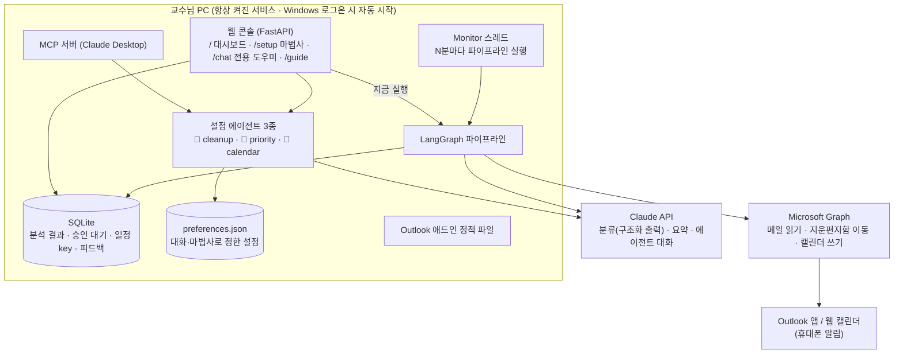

# 아키텍처



## LangGraph 파이프라인 (`mail_agent/graph.py`)

| 노드 | 하는 일 | LLM |
|---|---|---|
| `fetch_mail` | 계정마다 Graph로 새 메일 읽기 (처리한 메일 제외, 첫 실행은 7일 백필) | – |
| `prefilter` | `(광고)` 같은 규칙 매칭은 LLM 없이 '참고 + 정리 후보'로 분류 | – |
| `triage_one` × N | `Send`로 병렬 분류. 결과: 제목·요약·카테고리·우선순위·마감·일정·준비 필요 여부·정리 후보 | ✅ |
| `prioritize` | **마감 날짜가 우선순위 칸을 결정**(모델 제안보다 우선), 어제 할 일 이월, 저장 | – |
| `plan_cleanup` | 정리 후보 → 승인 대기 제안(ask) 또는 지운 편지함 이동(auto) | – |
| `plan_calendar` | 확신도 ≥ 기준이면 자동 등록, 아니면 '확인 필요'. 준비가 필요한 마감에는 `[점검 D-n]` 추가 | – |
| `review_calendar` | (CLI `--interactive`) LangGraph `interrupt`로 사람 승인 | – |
| `sync_calendar` | Outlook 캘린더 등록. `transactionId`와 일정 key로 중복 방지 | – |
| `sync_checklist` | 하루 하나 '✅ 오늘 할 일' 일정 생성 또는 갱신, 시작 시 알림 | – |
| `compose_digest` | 결정적 템플릿 + 짧은 요약 | ✅ |
| `notify` / `finalize` | 콘솔·파일·(선택) 메일·웹훅, 실행 시각 기록 | – |

LLM 호출이 실패해도 메일은 '(자동 분류 실패) 원문 확인'으로 남고, 다음 실행에서 다시 시도합니다.

## 설정 에이전트와 가드레일 (`mail_agent/agents.py`, `assistant.py`)

한 챗봇이 모든 설정을 다루면 사용자도 헷갈리고 모델도 범위를 벗어나기 쉽습니다. 그래서 항목별로 나눴습니다.

| 에이전트 | 바꿀 수 있는 설정 | 도구 |
|---|---|---|
| 🧹 불필요 메일 정리 | `cleanup` | get_status, update_preferences, scan_mailbox, find_mails_for_rule, propose_cleanup |
| 📌 우선순위·중요 발신자 | `priority_rules`, `vip_senders`, `owner_description` | get_status, update_preferences |
| 📅 캘린더·알림 | `calendar` | get_status, update_preferences |

코드로 강제하는 가드레일:
1. **도구 화이트리스트:** 에이전트에 없는 도구를 호출하면 거부합니다.
2. **설정 범위 검사:** `update_preferences`의 키가 범위 밖이면 거부합니다(`check_patch`).
3. **환각 id 차단:** `find_mails_for_rule`이 돌려준 id 중 저장소에 없는 것은 버립니다.
4. **첫 인사는 템플릿:** 저장된 분류 결과로 만들고, 모델이 생성하지 않습니다.
5. **파괴적 동작은 사람이 승인:** 모델은 정리 '제안'만 만듭니다. 이동은 웹의 승인 버튼(또는 Claude Desktop의 도구 승인) 뒤에만 실행되고, 지운 편지함으로만 옮깁니다.
6. **프롬프트 인젝션 방어:** 메일은 `<email>` 태그 안의 신뢰할 수 없는 데이터로 취급합니다. 분류 모델에는 도구가 없습니다.

## 연결 상태 (health check)
`GET /api/health/full`은 다음 네 가지만 ✅/⚠️/❌로 돌려줍니다.
- 서비스: 백그라운드 자동 확인이 켜져 있는지
- Claude: 모델 조회가 되는지
- Outlook 메일: 계정마다 받은편지함을 읽을 수 있는지
- Outlook 캘린더: 쓰기 권한이 있는지, 앞으로 등록된 MailAgent 일정 수와 Outlook 링크

## 인증과 권한
- Microsoft: MSAL 공용 클라이언트와 device code 로그인을 씁니다. 토큰 캐시는 `data/`에 저장합니다.
  - 위임 권한: `Mail.ReadWrite`, `Calendars.ReadWrite`, `Mail.Send`, `User.Read`
  - 앱 계정 유형: 모든 조직 + 개인 Microsoft 계정
- Claude: 조직 키와 `anthropic-workspace-id` 헤더를 씁니다.
  - 분류·대화 모두 Sonnet 5.5가 기본입니다. 대시보드에서 Opus 5.5로 바꿀 수 있습니다.
  - 월 $380 크레딧이면 Sonnet으로 충분해서 Haiku는 선택지에서 뺐습니다.
  - Opus/Sonnet 호출에는 서버 측 refusal fallback을 켰습니다.
- 웹 API: 기본은 localhost 전용(dev)입니다. 애드인 배포 시 Entra 토큰(NAA) 검증 모드를 씁니다.

## 디렉터리
```
mail_agent/   graph.py(파이프라인) llm.py(Claude) agents.py assistant.py(에이전트) api.py(FastAPI)
              msgraph.py(Graph) calendars.py prioritize.py store.py preferences.py service.py(런타임·모니터)
              actions.py(승인 실행) mcp_server.py
web/          index.html(대시보드) setup.html(마법사) chat.html(도우미) guide.html(사용법) + js/css, guide/*.jpg
addin/        Outlook 애드인 (manifest.xml, taskpane)
scripts/      install_service.ps1 · start_background.ps1 · uninstall_service.ps1
tests/        오프라인 테스트 25개
docs/         DEVELOPMENT_LOG.md · ARCHITECTURE.md · SETUP_WITH_CLAUDE.md · admin-consent-request.md
```
